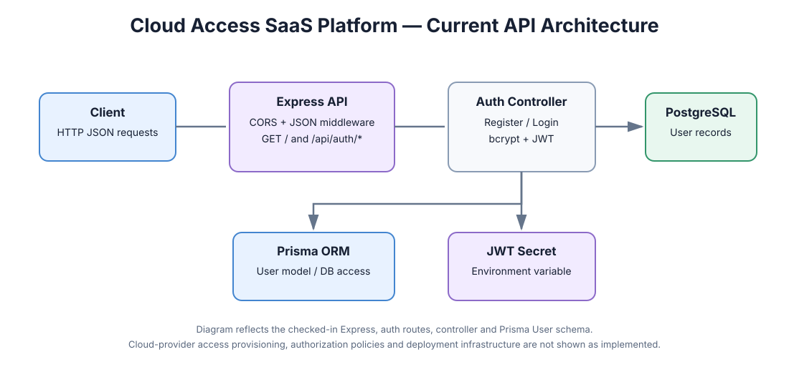
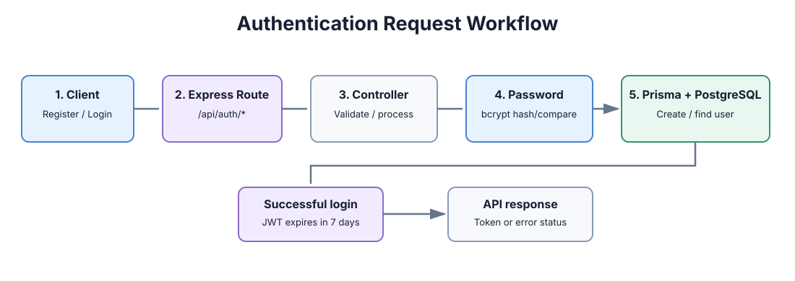

# Cloud Access SaaS Platform

A Node.js and Express API scaffold with email/password registration and login, bcrypt password hashing, JWT issuance, and Prisma access to a PostgreSQL user model.

## Architecture

[Open system architecture diagram](docs/images/system-architecture.svg)

## Authentication workflow

[Open authentication workflow diagram](docs/images/auth-workflow.svg)

## Current implementation

- Express server with configurable CORS and a 32 KB JSON request-body limit.
- Set `CORS_ORIGINS` to a comma-separated list of allowed browser origins in deployed environments. When unset, the API allows any origin for development; requests without an Origin header remain supported.
- `POST /api/auth/register` creates a user with a bcrypt-hashed password.
- `POST /api/auth/login` verifies the password and returns a JWT with a seven-day expiry.
- Prisma `User` model backed by PostgreSQL.
- Credential validation normalizes email addresses, checks email syntax, requires at least eight password characters, and enforces bcrypt's 72-byte UTF-8 input limit.
- Node's built-in test runner is configured with `npm test`; credential validation tests live in `test/`.

## Important scope note

The checked-in code demonstrates authentication basics. Cloud-provider IAM provisioning, tenant isolation, access-policy management, billing flows, production deployment, and authorization middleware should not be considered implemented unless added and tested separately. Configure `JWT_SECRET`, `CORS_ORIGINS`, and database connectivity securely before running outside local development.

## Run locally

1. Install a supported Node.js version.
2. Run `npm install`.
3. Configure environment variables for PostgreSQL and `JWT_SECRET` according to the Prisma version in use.
4. Generate the Prisma client and apply the required database migrations.
5. Run the test suite with `npm test`.
6. Start the API with `npm start`.
